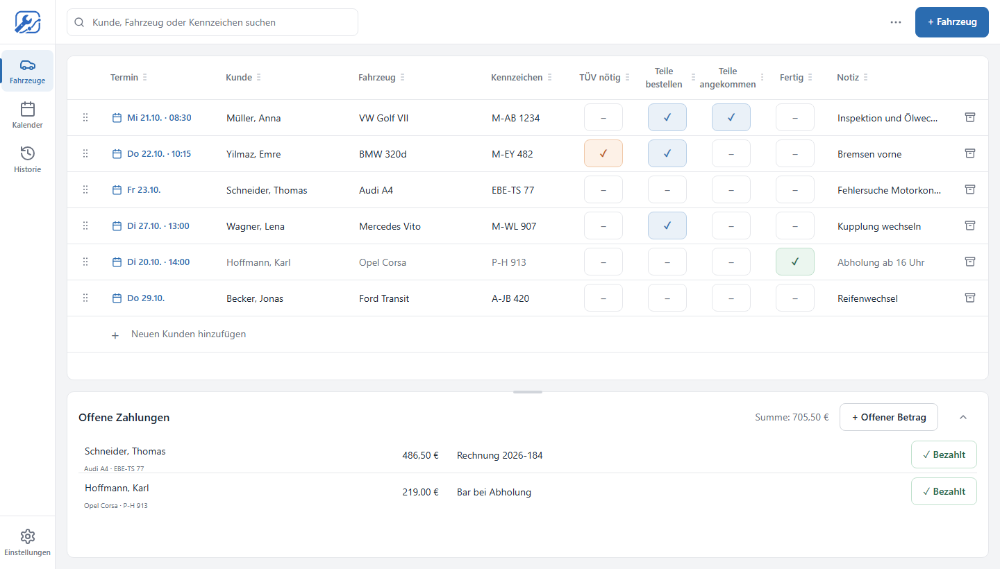
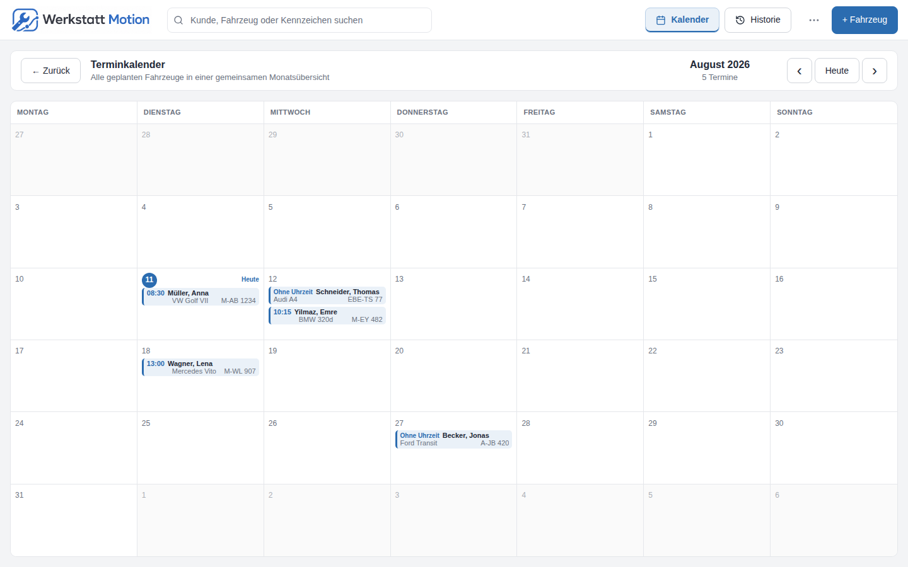

<p align="center">
  
</p>

<p align="center"><strong>Alle Fahrzeuge, Arbeiten und offenen Zahlungen auf einen Blick.</strong></p>

Werkstatt Motion ist eine einfache Anwendung für den täglichen Werkstattbetrieb.
Keine verschachtelten Menüs, kein unnötiger Papierkram – einfach öffnen und loslegen.



## Das Wichtigste im Überblick

- Fahrzeuge und Kunden übersichtlich verwalten
- Werkstatttermine direkt am Fahrzeug planen und im Kalender überblicken
- Arbeitsstand mit einem Klick markieren
- TÜV und bestellte Teile im Blick behalten
- Offene Zahlungen direkt sehen und als bezahlt markieren
- Zusätzliche Kosten diskret in einem versteckten Bereich erfassen
- Fahrzeuge schnell nach Kunde, Kennzeichen oder Modell finden
- Erledigte Aufträge in der Historie nachschlagen
- Daten täglich automatisch sichern – zusätzlich auf einem USB-Stick oder Netzlaufwerk
- Neue Versionen direkt in der App suchen und sicher installieren
- Funktioniert auch ohne Internet

## So einfach geht's

### Zwischen Bereichen wechseln

Links am Fensterrand liegt die Leiste mit den Bereichen **„Fahrzeuge“**,
**„Kalender“** und **„Historie“**. Ein Klick wechselt direkt in den Bereich;
der aktuelle Bereich ist blau markiert.

Jeder Bereich bringt seine eigene Kopfzeile mit: Die Suche und **„+ Fahrzeug“**
stehen nur im Bereich **„Fahrzeuge“**, die Historie hat ihre eigene Suche, und
der Kalender zeigt dort Monat und Navigation. Strg+F springt in die Suche des
aktuellen Bereichs.

Ganz unten in der Leiste liegen die **„Einstellungen“**. Dort steht jeder Bereich
einzeln in einer Liste, daneben seine Einstellungen. Bereiche, die noch keine
haben, zeigen einen Hinweis. Bei **„Fahrzeuge“** lassen sich die Spalten der
Fahrzeugliste ein- und ausblenden und ihre Reihenfolge zurücksetzen. Unter den
Bereichen steht die **„Datensicherung“** für die ganze App (siehe unten). Wo
etwas eine Erklärung braucht, steht ein kleiner Info-Knopf (ⓘ): Beim
Darüberfahren oder Anklicken zeigt er, was dort passiert.

### Fahrzeug anlegen

Oben rechts auf **„+ Fahrzeug“** klicken und Kunde, Fahrzeug oder Kennzeichen
eintragen. Die Angaben werden automatisch gespeichert.

### Arbeitsstand ändern

Bei **„TÜV nötig“**, **„Teile bestellen“**, **„Teile angekommen“** oder
**„Fertig“** einfach auf das passende Feld klicken.

### Notizen bearbeiten

Beim Darüberfahren zeigt eine gefüllte Notiz weiterhin ihre vollständige
Vorschau. Ein Klick öffnet diese Fläche als großen mehrzeiligen Editor. Beim
Verlassen wird automatisch gespeichert; **Strg+Enter** speichert direkt und
**Esc** verwirft die aktuelle Änderung.

### Reihenfolge festlegen

Wichtige Fahrzeuge lassen sich am Griff links nach oben ziehen. So steht der
dringendste Auftrag immer ganz oben. Auch die Tabellenspalten – einschließlich
**„Termin“** – lassen sich am Spaltenkopf verschieben; ihre Reihenfolge wird
automatisch gespeichert.

### Fahrzeugtermin planen

In der Spalte **„Termin“** auf **„Termin hinzufügen“** beziehungsweise den
vorhandenen Termin klicken. Datum und optional eine Uhrzeit auswählen und
speichern; der Wochentag wird automatisch ermittelt. Die Uhrzeit kann leer
bleiben. Mit **„Termin entfernen“** lässt sich die Planung wieder löschen.

Der Termin darf auch zuerst kommen – praktisch, wenn ein Kunde am Telefon
zunächst sagt, wann er kommen kann: Nach **„+ Fahrzeug“** in der neuen Zeile
auf **„Termin hinzufügen“** klicken, Datum und Uhrzeit wählen und mit
**„Termin speichern“** bestätigen. Der Cursor springt danach in das Feld
**„Kunde“**. Gespeichert wird die Zeile samt Termin, sobald Kunde sowie Fahrzeug
oder Kennzeichen eingetragen sind und die Zeile verlassen wird. Ein Termin ohne
Kunden wird nicht aufgehoben: Wird die Zeile ohne Kunden verlassen, ist der
Eintrag wieder verworfen.

Über **„Kalender“** in der Leiste links öffnet sich die Monatsübersicht.
Dort erscheinen dieselben Fahrzeugtermine mit Uhrzeit beziehungsweise dem
Hinweis **„Ohne Uhrzeit“**, Kunde, Fahrzeug und Kennzeichen. Änderungen aus der
Fahrzeugliste sind unmittelbar auch im Kalender sichtbar.

Über die Leiste links lässt sich jederzeit zwischen Fahrzeugen, anstehenden
Terminen und abgeschlossenen Vorgängen wechseln.



### Historie öffnen

Über **„Historie“** in der Leiste links werden abgeschlossene Fahrzeuge als
unveränderliche Snapshots angezeigt. Zusätzlich sind dort bereits bezahlte
Kosten mit Fahrzeug, Kennzeichen, Betrag und Zahlungszeitpunkt zu finden. Das
Suchfeld filtert beide Bereiche gemeinsam.

### Offene Zahlung eintragen

Im Bereich **„Offene Zahlungen“** auf **„+ Offener Betrag“** klicken. Sobald
bezahlt wurde, genügt ein Klick auf **„✓ Bezahlt“**.

### Versteckte Kosten erfassen

Das Werkstattlogo oben links drei Sekunden lang gedrückt halten. Daraufhin
öffnet sich der Bereich **„Versteckte Einträge“**. Dort lassen sich über
**„+ Eintrag“** eine Bezeichnung, ein Betrag und eine Notiz erfassen.

Mit **„ד** wird der Bereich wieder geschlossen. Die Einträge sind damit in der
normalen Ansicht nicht sichtbar. Das Verstecken ist jedoch kein Passwortschutz.

### Fahrzeug suchen

Oben den Namen, das Kennzeichen oder das Fahrzeug eingeben. Die passende Zeile
erscheint sofort.

## Installation

### Windows

1. Die Installationsdatei auf den Werkstatt-PC kopieren.
2. Die Datei doppelt anklicken und die Installation bestätigen.
3. **Werkstatt Motion** über das Startmenü öffnen.

Es werden keine zusätzlichen Programme und keine Anmeldung benötigt.

### Linux

Für Ubuntu, Debian, Linux Mint und verwandte Distributionen im neuesten
[GitHub Release](https://github.com/Oko-Tester/Werkstatt-Motion/releases/latest)
die Datei mit der Endung `.deb` herunterladen. Anschließend die Datei über die
Softwareverwaltung öffnen oder im Download-Ordner installieren:

```bash
sudo apt install ./*.deb
```

Danach lässt sich **Werkstatt Motion** wie andere Anwendungen über das
Anwendungsmenü starten.

Alternativ steht im Release ein `.AppImage` für weitere Linux-Distributionen
bereit. Nach dem Download muss es einmal ausführbar gemacht werden:

```bash
chmod +x ./*.AppImage
./*.AppImage
```

Die bereitgestellten Linux-Pakete sind für 64-Bit-PCs (`x86_64`) vorgesehen.

## Updates

Im Drei-Punkte-Menü oben rechts auf **„Nach Updates suchen“** klicken. Ist eine
neue Version verfügbar, zeigt Werkstatt Motion die Versionsnummer an. Das
Update startet erst nach einem Klick auf **„Update installieren“**.

Vor der Installation erstellt die App automatisch ein vollständiges
Sicherheits-Backup. Es landet im Unterordner `Backups` neben der installierten
Programmdatei; ist dieser Ordner nicht beschreibbar – unter Linux etwa bei
einer Paketinstallation nach `/usr/bin` oder bei einem AppImage –, weicht die
App auf den Backup-Ordner im Anwendungsdatenverzeichnis aus. Erst wenn auch
dort keine vollständige Sicherung geschrieben werden kann, wird das Update
nicht durchgeführt. Für die Update-Suche wird kurzzeitig eine
Internetverbindung benötigt; ansonsten bleibt Werkstatt Motion vollständig
offline nutzbar.

## Datensicherung

Werkstatt Motion erstellt automatisch höchstens ein vollständiges Backup pro
Kalendertag. Beim App-Start wird sofort geprüft, ob die heutige Sicherung fehlt;
bei länger geöffneter App läuft diese Prüfung stündlich weiter. Tägliche Backups
werden für 14 Tage aufbewahrt, ältere tägliche Sicherungen löscht die App
automatisch – die drei neuesten bleiben aber immer erhalten, auch wenn sie älter
sind. So geht nach einer längeren Pause (Urlaub, defekter Rechner) die letzte gute
Sicherung davor nicht verloren. Dazu muss die App an dem jeweiligen Tag geöffnet
sein.

Die täglichen Sicherungen liegen im Anwendungsdatenverzeichnis:

```text
Windows: %APPDATA%\de.werkstattmotion.desktop\backups
Linux:   ~/.local/share/de.werkstattmotion.desktop/backups
```

### Zweiter Speicherort und „Jetzt sichern“

Unter **„Einstellungen“ › „Datensicherung“** steht, wann zuletzt gesichert wurde –
auf diesem Computer und am zweiten Speicherort. Mit **„Ordner wählen …“** (später
**„Ändern …“**) lässt sich ein Ordner auf einem USB-Stick oder Netzlaufwerk
festlegen, **„Entfernen“** nimmt ihn wieder heraus. Die App legt darin einen
eigenen Ordner an (`Werkstatt-Motion-Sicherung-<Computername>`) und sichert nur
dort: Jeden Tag kommt eine Kopie hinzu (`taeglich-…`), und nach 14 Tagen räumt sie
dort wie auf dem Computer auf (auch hier bleiben mindestens die drei neuesten) –
ausschließlich ihre eigenen täglichen Dateien.
Alles andere im gewählten Ordner bleibt unberührt, und mehrere Computer können
sich einen Stick teilen. Die erste Kopie entsteht gleich nach dem Einrichten.

Außer diesem eigenen Ordner legt die App im zweiten Speicherort nie etwas an. Ist
der USB-Stick nicht eingesteckt oder das Netzlaufwerk nicht verbunden – oder steckt
am selben Laufwerksbuchstaben ein anderer Datenträger –, schreibt sie nichts auf ein
anderes Laufwerk. Stattdessen weist sie darauf hin (einmal pro Tag) und zeigt es in
den Einstellungen rot an. Liegt die letzte Sicherung mehr als zwei Tage zurück,
färbt sich auch diese Zeile rot. Sobald der Ordner wieder erreichbar ist, holt die
App die heutige Kopie beim nächsten Prüflauf nach.

**„Jetzt sichern“** schreibt sofort eine Sicherung in den zweiten Speicherort
(`manuell-<Datum>_<Uhrzeit>.werkstattbackup`); manuelle Sicherungen löscht die
App nie. Ist noch kein zweiter Speicherort eingerichtet, fragt sie wie das Menü
**„Backup“** nach dem Ziel. Die Wahl des Ordners steht in der Datei
`sicherung.json` neben der Datenbank und bleibt auch nach einer
Wiederherstellung erhalten.

### Backup von Hand

Über **„Backup“** im Drei-Punkte-Menü lässt sich jederzeit eine Sicherung an
einem frei gewählten Ort erstellen – zum Beispiel auf einem USB-Stick. Mit
**„Wiederherstellen“** kann eine Sicherung später wieder eingespielt werden.

**Empfehlung:** Einen zweiten Speicherort einrichten und regelmäßig ein Backup
getrennt vom Werkstatt-PC aufbewahren.

### Automatische Sicherung wiederherstellen

Tägliche Sicherungen und Sicherungen vor einer Wiederherstellung liegen in den
oben genannten App-Datenpfaden. Unter Linux kann `$XDG_DATA_HOME` den Ordner
`~/.local/share` ersetzen. Die verpflichtende Sicherung vor einem Update liegt
im Unterordner `Backups` neben der installierten Programmdatei – und, wenn dort
keine Schreibrechte bestehen, ebenfalls in den oben genannten App-Datenpfaden.
Unter Linux ist das der Regelfall: `.deb`-Installationen liegen unter `/usr`,
und ein AppImage läuft aus einem schreibgeschützten Mount.

So lässt sich die Sicherung öffnen und wieder einspielen:

1. Den oben genannten Ordner im Dateimanager öffnen.
2. Die gewünschte Datei auswählen. Tägliche Sicherungen beginnen mit
   `taeglich-`, Update-Sicherungen mit `vor-update-`; beide enden auf
   `.werkstattbackup`.
3. Werkstatt Motion öffnen und im Drei-Punkte-Menü auf
   **„Wiederherstellen“** klicken.
4. Die Backup-Datei aus dem Ordner auswählen und
   **„Jetzt wiederherstellen“** bestätigen.

## Lizenz

Werkstatt Motion ist unter der [MIT-Lizenz](LICENSE) veröffentlicht. Die App
und ihr Quellcode dürfen damit verwendet, verändert und weitergegeben werden,
sofern der Lizenz- und Urheberrechtshinweis erhalten bleibt.

---

Werkstatt Motion wurde für den Werkstattalltag gemacht: schnell verständlich,
direkt bedienbar und ohne technisches Drumherum.
